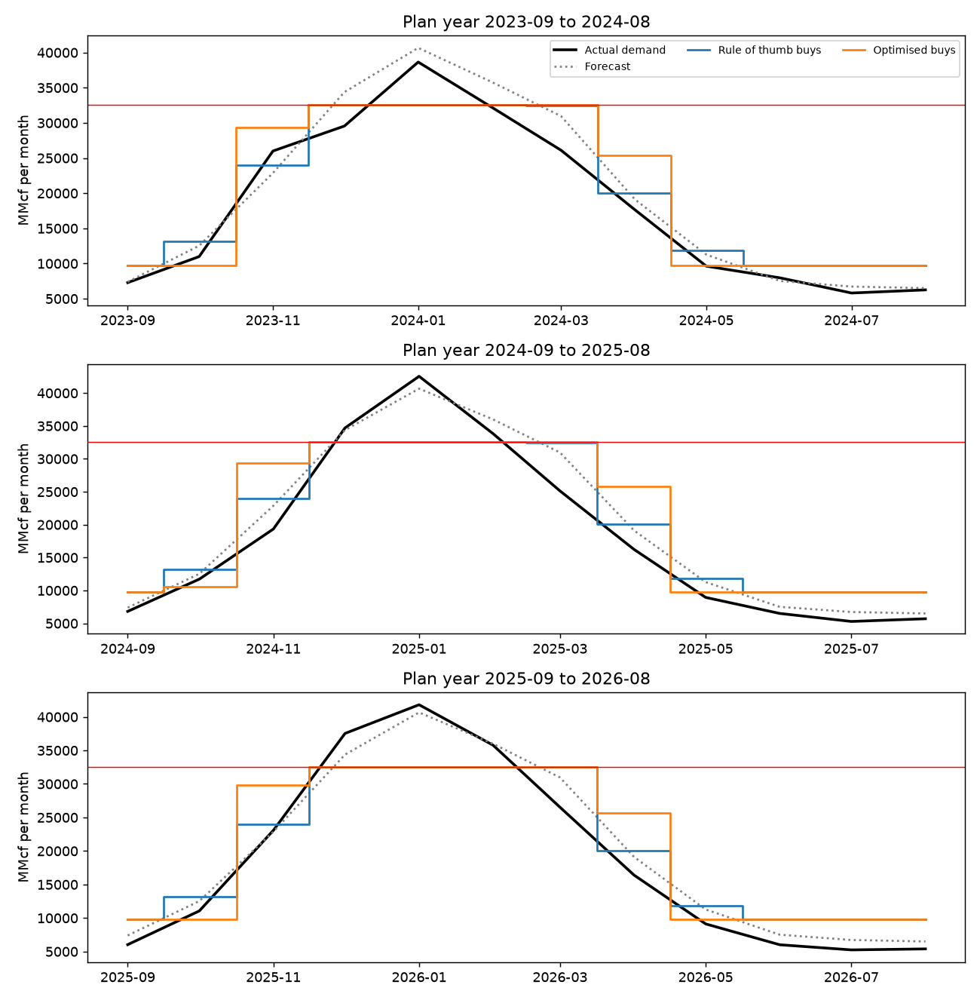
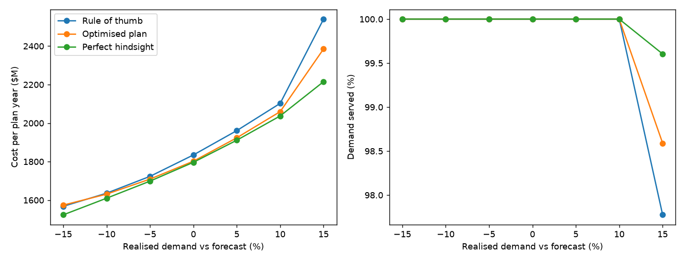

# Milestone 2: supply plan optimisation

A gas utility must decide, before winter, how much pipeline gas to buy each month and whether
to contract peaking supply. The M1 forecast sets the expected demand. This milestone turns that
forecast into a plan, then compares the plan with a simple rule of thumb on cost and service
level. Regenerate with `python scripts/run_m2.py` after `python scripts/run_m1.py`.

## Formulation

**Sets and data.** Months `t = 1..12` of a plan year starting in September. Scenarios `s`,
one per historical weather year, each with equal probability `1/S`. Demand `D[s,t]` in MMcf,
citygate price `p[t]` in $/Mcf. The parameters named below are the assumptions in the table.

**First-stage decisions, made before the weather is known.**

```
x[t]  in [minTake, pipelineCap]    pipeline nomination, MMcf, bought at p[t]
y[t]  in {0, 1}                    1 if peaking supply is contracted in month t
```

**Second-stage decisions, made once the scenario is known, for every `s` and `t`.**

```
w[s,t] in [0, wLimit]      storage withdrawal
i[s,t] in [0, iLimit]      storage injection
v[s,t] in [0, storageCap]  storage inventory at the end of the month
g[s,t] >= 0                peaking gas called
r[s,t] >= 0                surplus gas resold
u[s,t] in [0, D[s,t]]      demand left unserved
```

**Constraints.**

```
x[t] + w[s,t] - i[s,t] + g[s,t] - r[s,t] + u[s,t] = D[s,t]     demand balance
v[s,t] = v[s,t-1] + i[s,t] - w[s,t],  v[s,0] = startFraction * storageCap
g[s,t] <= peakingCap * y[t]                                     peaking only if contracted
```

**Objective: minimise expected total cost, in $M.**

```
sum_t p[t] x[t] + standbyFee * sum_t y[t]
+ (1/S) * sum_s sum_t ( injFee*i + wdFee*w + peakMultiple*p[t]*g
                        + penalty*u - resaleFraction*p[t]*r )
- avgPrice * (1/S) * sum_s v[s,12]
```

The last term values the gas left in storage at the plan year's average price. Without it the
model would empty storage for free at the end of the year.

Because `y` is binary, this is a mixed integer program. It is solved as one deterministic
equivalent problem with SCIP through OR-Tools. The same model, with `x` and `y` fixed and a
single demand path, scores any plan against what actually happened. With one demand path and
`x` and `y` free it gives the perfect hindsight cost, which no real plan can beat.

## Assumptions

The data sources supply demand, weather and citygate prices. Everything else below is an
assumption chosen to make the problem realistic, not a measured fact. The results depend on
these numbers, so change them in `SupplyAssumptions` and rerun to test other cases.

| Item | Value |
|---|---|
| Pipeline capacity | 80% of the expected peak month: 32,534, 32,534, 32,534 MMcf |
| Pipeline minimum take | 30% of capacity each month |
| Storage working capacity | 12% of expected annual demand: 28,288, 28,311, 28,311 MMcf |
| Storage at the start of the plan year | 80% full |
| Storage injection and withdrawal limits | 25% and 35% of capacity per month |
| Storage fees | $0.15 per Mcf in, $0.10 per Mcf out |
| Leftover storage gas | valued at the plan year's average citygate price |
| Peaking capacity | 8% of the expected peak month when contracted: 3,253, 3,253, 3,253 MMcf |
| Peaking price | 2.0 times the citygate price |
| Peaking standby fee | $2.0M per contracted month |
| Cost of unserved demand | $60 per Mcf |
| Resale of surplus gas | 50% of the citygate price |
| Pipeline gas price | the month's EIA citygate price, treated as known in advance |

## The plans compared

* **Rule of thumb.** Buy the M1 normal-weather forecast plus a 5% reserve each
  month, within the pipeline's minimum take and capacity. Contract peaking in December, January
  and February.
* **Optimised plan.** The stochastic program above, over 30 demand
  scenarios. Each scenario is a past winter's weather (September to August) run through the M1
  regressions. Only weather from before the M1 forecast origin is used.
* **Perfect hindsight.** The cheapest plan if the realised demand had been known in advance.
  It is a floor, not a plan anyone could make.

All three face the same limits, and every plan is scored with the best storage, peaking and
resale decisions for the demand that happened.

## Results on the demand that happened

Plan years run September to August over the M1 holdout. Demand is the actual EIA residential
plus commercial deliveries. Service is the share of demand delivered.

| Plan | Cost ($M) | Demand served (%) | Months with shortfall | Peaking gas used (MMcf) |
|---|---|---|---|---|
| Rule of thumb | 5077.4 | 100.00 | 0 | 99 |
| Optimised plan | 5053.3 | 100.00 | 0 | 99 |
| Perfect hindsight | 5007.5 | 100.00 | 0 | 99 |

Over the three plan years the optimised plan cost $5053.3M against $5077.4M for the rule of thumb, which is $24.1M cheaper. Perfect hindsight cost $5007.5M. Both plans served 100.00% of demand. It closes 34% of the gap between the rule and hindsight.

By plan year:

| Plan year | Plan | Cost ($M) | Demand served (%) | Months with shortfall | Peaking gas used (MMcf) |
|---|---|---|---|---|---|
| 2023-09 to 2024-08 | Rule of thumb | 1452.7 | 100.00 | 0 | 0 |
| 2023-09 to 2024-08 | Optimised plan | 1439.8 | 100.00 | 0 | 0 |
| 2023-09 to 2024-08 | Perfect hindsight | 1428.9 | 100.00 | 0 | 0 |
| 2024-09 to 2025-08 | Rule of thumb | 1683.6 | 100.00 | 0 | 99 |
| 2024-09 to 2025-08 | Optimised plan | 1687.5 | 100.00 | 0 | 99 |
| 2024-09 to 2025-08 | Perfect hindsight | 1665.1 | 100.00 | 0 | 99 |
| 2025-09 to 2026-08 | Rule of thumb | 1941.1 | 100.00 | 0 | 0 |
| 2025-09 to 2026-08 | Optimised plan | 1926.0 | 100.00 | 0 | 0 |
| 2025-09 to 2026-08 | Perfect hindsight | 1913.6 | 100.00 | 0 | 0 |



## Results over the weather scenarios

The same two plans, scored on the 30 weather scenarios the optimiser
saw. This isolates weather risk from model error.

The scenarios differ between plan years only in days per month, so the three plan years see
nearly the same weather risk.

| Plan year | Plan | Expected cost ($M) | Expected demand served (%) | Scenarios with shortfall | Scenarios |
|---|---|---|---|---|---|
| 2023-09 to 2024-08 | Rule of thumb | 1614.6 | 99.86 | 5 | 30 |
| 2023-09 to 2024-08 | Optimised plan | 1593.6 | 99.86 | 5 | 30 |
| 2024-09 to 2025-08 | Rule of thumb | 1888.8 | 99.86 | 5 | 30 |
| 2024-09 to 2025-08 | Optimised plan | 1863.8 | 99.86 | 5 | 30 |
| 2025-09 to 2026-08 | Rule of thumb | 2098.8 | 99.86 | 5 | 30 |
| 2025-09 to 2026-08 | Optimised plan | 2071.6 | 99.86 | 5 | 30 |

## Sensitivity to forecast error

Both plans are made on the forecast. Realised demand is then the forecast times (1 + error)
in every month, averaged over the three plan years. The hindsight column re-plans for each
error, so the gap to it is the cost of having planned on the wrong forecast.

Cost per plan year, $M:

| Realised demand vs forecast (%) | Rule of thumb | Optimised plan | Perfect hindsight |
|---|---|---|---|
| -15 | 1567.8 | 1574.1 | 1523.6 |
| -10 | 1636.1 | 1631.2 | 1610.1 |
| -5 | 1723.5 | 1709.3 | 1698.7 |
| +0 | 1834.7 | 1802.1 | 1796.5 |
| +5 | 1961.0 | 1923.8 | 1911.1 |
| +10 | 2102.5 | 2059.6 | 2037.2 |
| +15 | 2540.1 | 2385.2 | 2215.3 |

Share of demand served, %:

| Realised demand vs forecast (%) | Rule of thumb | Optimised plan | Perfect hindsight |
|---|---|---|---|
| -15 | 100.00 | 100.00 | 100.00 |
| -10 | 100.00 | 100.00 | 100.00 |
| -5 | 100.00 | 100.00 | 100.00 |
| +0 | 100.00 | 100.00 | 100.00 |
| +5 | 100.00 | 100.00 | 100.00 |
| +10 | 100.00 | 100.00 | 100.00 |
| +15 | 97.77 | 98.59 | 99.60 |

At +15% the rule of thumb costs $2540.1M and serves 97.77% of demand, the optimised plan $2385.2M and 98.59%, and perfect hindsight $2215.3M. At -15% the rule of thumb costs $1567.8M and serves 100.00% of demand, the optimised plan $1574.1M and 100.00%, and perfect hindsight $1523.6M.



## Limitations

* The infrastructure sizes, fees and penalties are assumptions. A different penalty for unserved
  demand or a different standby fee can change which plan wins.
* Pipeline gas is priced at the month's realised citygate price, so price risk is out of scope.
  Only demand is uncertain.
* In this EIA series the Massachusetts citygate price is higher in summer than in winter, in
  every period since 1989. The plans respond to that shape, so storage is cheap to draw down in
  summer and the usual summer-fill logic does not apply. A different price series would change
  the storage behaviour.
* The EIA citygate price is missing for 2026-03. It was filled by linear interpolation between the neighbouring months.
* The scenarios hold the weather of a past year fixed across the whole plan year and ignore the
  M1 model's own error, which is why the error sensitivity above is reported separately.
* Storage and peaking are dispatched with knowledge of the whole year's demand, which flatters
  every plan equally. Real operations dispatch month by month.
* Monthly steps hide the daily peaks that drive real peaking decisions.
* Three plan years are a small sample.
