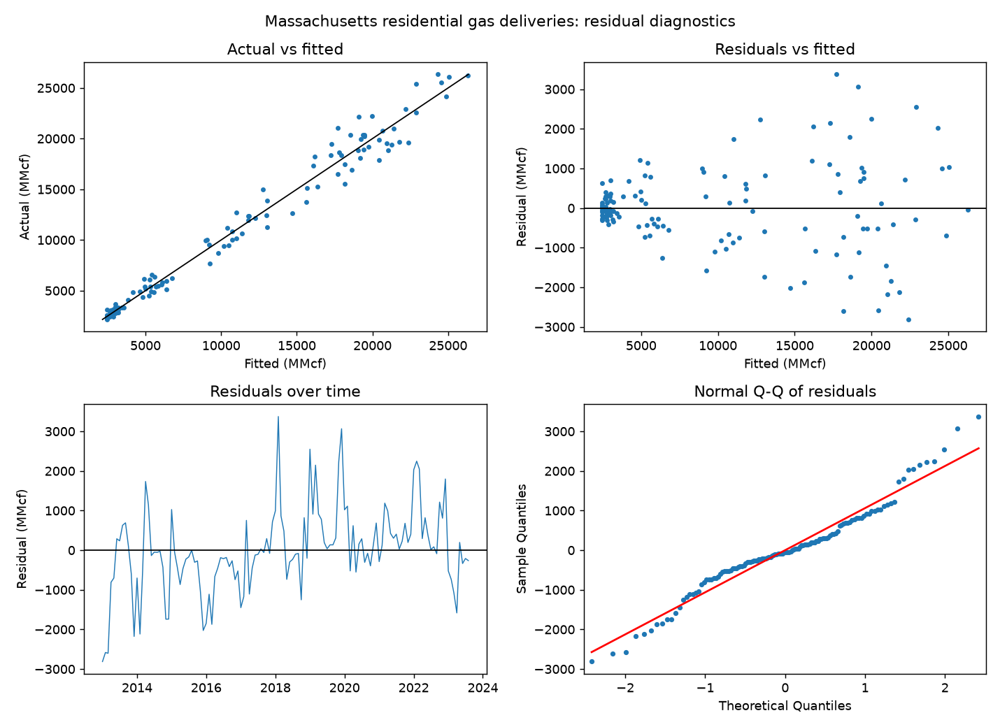
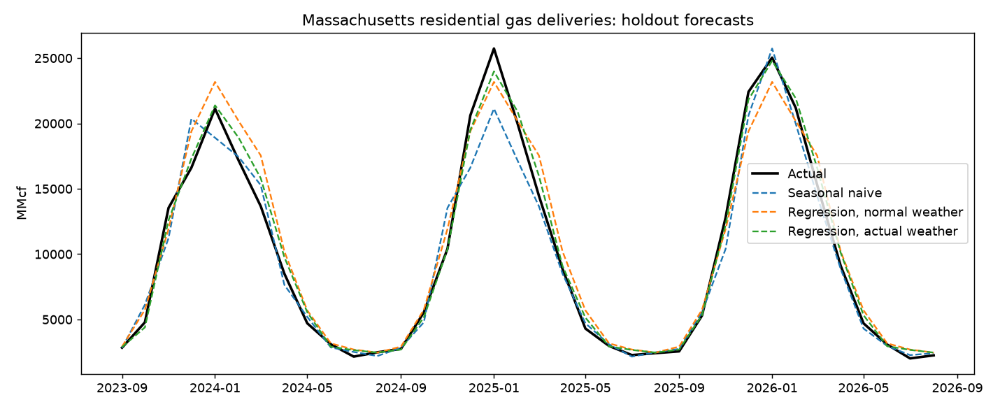
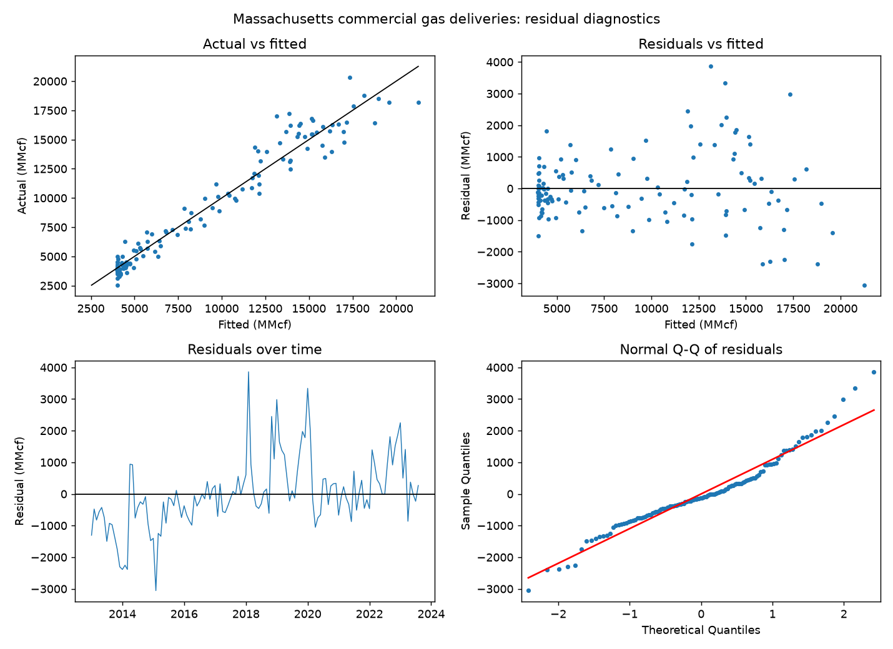
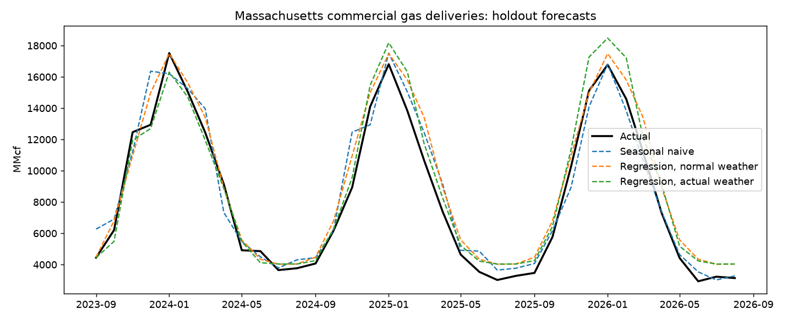

# Milestone 1: interpretable forecast

Massachusetts monthly natural gas deliveries (EIA) against heating degree days at
Boston Logan (NOAA). Data span: 1989-02 to 2026-08. Regenerate with `python scripts/run_m1.py`.

## Method

Each sector (residential, commercial) is a linear regression on named drivers: heating degree
days (HDD, base temperature chosen below), last month's HDD for billing lag, and days in the
month. Monthly data has no day-of-week or holiday effect, so days in month replaces them.
Month effects are an optional candidate for the seasonal shape.

The first training year, HDD base temperature and month effects are chosen by validation. Each
candidate is fitted on the training period without its last 36 months and scored
on those 36 months using normal weather. The holdout of the final
36 months is removed before this choice, scored once, and not used to tune
anything. Candidates: first year in 1989, 2000, 2008, 2013; base temperature in
60, 62, 65 F; month effects on or off.

Three forecasts are compared on the holdout:

* Seasonal naive: the same month one year earlier. It sees fresh data every month, which is
  generous to the baseline.
* Regression with normal weather: the fitted model with each month's HDD replaced by its
  30-year average from the training period. This is the honest forecast, because weather is
  unknown in advance. Later milestones use it.
* Regression with actual weather: the same model given the weather that occurred. It is not a
  forecast. It shows how much of the error is weather and how much is the model.

Context found while exploring (before the specification search): a linear time trend fitted
from 1989 extrapolates badly, because annual deliveries grew until about 2013 and were flat
afterwards. The trend was dropped and shorter training windows were added as candidates.

## Residential deliveries

Chosen on validation: training from 2013, HDD base 60 F, with month effects. Fitted on 2013-01 to 2023-08 (128 months).

R² 0.980 (adjusted 0.978).

### Coefficients

Units: MMcf per unit of the driver. Standard errors and intervals are Newey-West (12 lags).

| term | coefficient | std error | 95% CI low | 95% CI high | p-value |
|---|---|---|---|---|---|
| const | 6760.26 | 27448.88 | -47038.55 | 60559.07 | 0.805 |
| hdd | 15.62 | 1.61 | 12.47 | 18.78 | <0.001 |
| hdd_lag1 | 3.12 | 1.12 | 0.93 | 5.30 | 0.005 |
| days_in_month | -8.33 | 893.71 | -1759.97 | 1743.32 | 0.993 |
| month_2 | -1465.85 | 2486.29 | -6338.90 | 3407.19 | 0.555 |
| month_3 | -1660.52 | 525.61 | -2690.71 | -630.34 | 0.002 |
| month_4 | -3734.59 | 1297.22 | -6277.09 | -1192.08 | 0.004 |
| month_5 | -3759.41 | 1456.94 | -6614.96 | -903.86 | 0.010 |
| month_6 | -3951.87 | 1815.12 | -7509.44 | -394.30 | 0.029 |
| month_7 | -3852.03 | 1779.32 | -7339.44 | -364.62 | 0.030 |
| month_8 | -4037.35 | 1795.49 | -7556.44 | -518.26 | 0.025 |
| month_9 | -3844.84 | 1827.41 | -7426.50 | -263.19 | 0.035 |
| month_10 | -3634.35 | 1628.76 | -6826.66 | -442.04 | 0.026 |
| month_11 | -2177.46 | 1399.08 | -4919.59 | 564.68 | 0.120 |
| month_12 | -62.32 | 781.59 | -1594.20 | 1469.56 | 0.936 |

### Residual diagnostics

| Test | Statistic or p-value | Reading |
|---|---|---|
| Durbin-Watson | 0.82 | 2 means no first-order autocorrelation |
| Ljung-Box, 12 lags | p = 1.1e-18 | small p: residuals are autocorrelated |
| Breusch-Pagan | p = 9.64e-05 | small p: variance is not constant |
| Jarque-Bera | p = 0.0157 | small p: residuals are not normal |

### Out-of-sample error, 2023-09 to 2026-08

| Forecast | MAE (MMcf) | RMSE (MMcf) | MAPE (%) |
|---|---|---|---|
| Seasonal naive | 1,101 | 1,656 | 10.2 |
| Regression, normal weather | 1,192 | 1,582 | 12.8 |
| Regression, actual weather | 627 | 837 | 7.9 |

With normal weather the regression does not beat the seasonal-naive baseline (12.8% vs 10.2% MAPE). With the weather that actually occurred it beats it (7.9% vs 10.2%).

## Commercial deliveries

Chosen on validation: training from 2013, HDD base 60 F, without month effects. Fitted on 2013-01 to 2023-08 (128 months).

R² 0.953 (adjusted 0.952).

### Coefficients

Units: MMcf per unit of the driver. Standard errors and intervals are Newey-West (12 lags).

| term | coefficient | std error | 95% CI low | 95% CI high | p-value |
|---|---|---|---|---|---|
| const | 9699.69 | 3246.92 | 3335.85 | 16063.53 | 0.003 |
| hdd | 15.35 | 0.76 | 13.86 | 16.84 | <0.001 |
| hdd_lag1 | -0.90 | 0.46 | -1.81 | 0.01 | 0.053 |
| days_in_month | -182.63 | 106.72 | -391.80 | 26.54 | 0.087 |

### Residual diagnostics

| Test | Statistic or p-value | Reading |
|---|---|---|
| Durbin-Watson | 0.72 | 2 means no first-order autocorrelation |
| Ljung-Box, 12 lags | p = 1.11e-35 | small p: residuals are autocorrelated |
| Breusch-Pagan | p = 3.67e-06 | small p: variance is not constant |
| Jarque-Bera | p = 5.31e-05 | small p: residuals are not normal |

### Out-of-sample error, 2023-09 to 2026-08

| Forecast | MAE (MMcf) | RMSE (MMcf) | MAPE (%) |
|---|---|---|---|
| Seasonal naive | 913 | 1,231 | 12.5 |
| Regression, normal weather | 974 | 1,163 | 15.1 |
| Regression, actual weather | 901 | 1,095 | 13.2 |

With normal weather the regression does not beat the seasonal-naive baseline (15.1% vs 12.5% MAPE). With the weather that actually occurred it does not beat it (13.2% vs 12.5%).

## Limitations

* The weather driver is one station (Boston Logan) for a whole state.
* Deliveries include gas billed in a later month, so the month-to-month link to HDD is blurred.
* A 36-month holdout is one fixed window, not a rolling evaluation, so the error estimates are
  noisy.
* Residual autocorrelation (see the tests above) means the intervals are wider than plain OLS
  would show, and the model leaves predictable structure unexplained.
