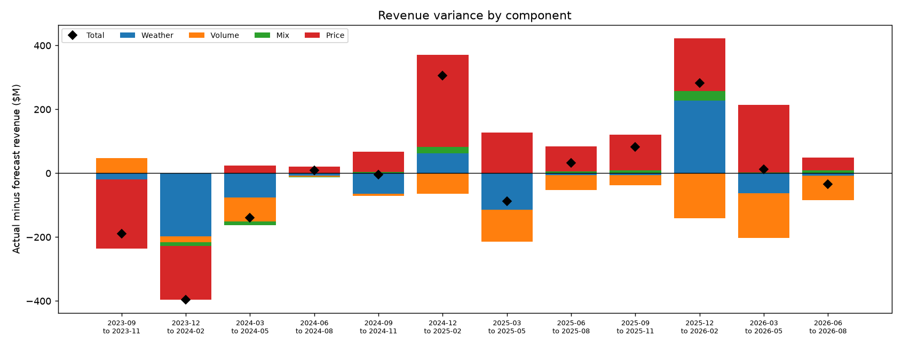

# Milestone 3: variance analysis

How far was the forecast from what happened, and why? This milestone takes the M1 normal
weather forecast for the last 36 months and explains the gap
to actual gas revenue with four named effects. Regenerate with `python scripts/run_m3.py`
after `python scripts/run_m1.py`.

## Method

Revenue is deliveries times the price each sector pays, summed over residential and
commercial customers. The forecast is the M1 normal weather forecast priced at a budget price.
The actual is what was delivered at the price that was charged. The gap is moved from forecast
to actual in four steps, and each step changes one thing, so the effects add up to the total:

1. **Weather.** Replace normal weather with the weather that happened, using the M1 regression
   for both. Effect: (weather adjusted forecast minus forecast) times budget price.
2. **Volume.** Move total deliveries from the weather adjusted forecast to the actual total,
   keeping the weather adjusted forecast's split between sectors. Effect: change in total
   volume times the budget price of that split.
3. **Mix.** Move from the weather adjusted forecast's split between residential and commercial
   to the actual split. The two sectors pay different prices, so the split changes revenue.
   Effect: actual volume times the change in each sector's share times its budget price.
4. **Price.** Charge the actual prices. Effect: actual volume times (actual minus budget price).

Positive means actual is above forecast. Periods are consecutive blocks of
3 months starting with the first month of the holdout. The effects are
computed month by month and added up within each period.

The budget price is an assumption, because the EIA data has no record of the prices a planner
assumed. The main table uses a rolling rule: each month is priced at the same month one year
earlier, as a budget set a year ahead would be. The M1 forecast itself was made once, with data
up to the start of the holdout, so the section on the budget price below repeats the analysis
with prices frozen at what was known then.

## Revenue variance

Millions of dollars. The four effects add up to the variance in every period. The largest
difference between their sum and the variance is 1.7e-13, which is rounding.

| Period | Forecast ($M) | Actual ($M) | Variance ($M) | Weather | Volume | Mix | Price |
|---|---|---|---|---|---|---|---|
| 2023-09 to 2023-11 | 815.1 | 626.3 | -188.7 | -19.9 | +47.9 | +0.1 | -216.9 |
| 2023-12 to 2024-02 | 2,318.2 | 1,922.2 | -396.0 | -197.5 | -19.0 | -11.3 | -168.2 |
| 2024-03 to 2024-05 | 1,163.2 | 1,023.0 | -140.2 | -76.3 | -75.5 | -11.6 | +23.3 |
| 2024-06 to 2024-08 | 306.9 | 315.2 | +8.3 | -8.2 | -3.4 | -1.2 | +21.1 |
| 2024-09 to 2024-11 | 604.1 | 599.3 | -4.9 | -64.9 | -6.8 | +4.2 | +62.6 |
| 2024-12 to 2025-02 | 2,139.2 | 2,444.9 | +305.7 | +62.3 | -64.6 | +20.8 | +287.2 |
| 2025-03 to 2025-05 | 1,190.2 | 1,103.0 | -87.2 | -114.9 | -98.9 | +1.1 | +125.6 |
| 2025-06 to 2025-08 | 329.1 | 361.1 | +32.0 | -6.7 | -45.6 | +6.0 | +78.3 |
| 2025-09 to 2025-11 | 676.3 | 758.6 | +82.2 | -6.1 | -32.3 | +8.8 | +112.0 |
| 2025-12 to 2026-02 | 2,419.8 | 2,701.7 | +282.0 | +227.5 | -140.7 | +29.0 | +166.1 |
| 2026-03 to 2026-05 | 1,344.5 | 1,356.8 | +12.3 | -62.4 | -140.0 | +2.8 | +211.8 |
| 2026-06 to 2026-08 | 418.5 | 383.5 | -35.0 | -8.1 | -75.5 | +9.1 | +39.5 |
| Total | 13,724.9 | 13,595.6 | -129.3 | -275.1 | -654.5 | +57.7 | +742.5 |

Over the 12 periods actual revenue was $129.3M below the forecast of $13,724.9M. The effects in $M were: weather -275.1, volume -654.5, mix +57.7, price +742.5. The largest effect over the whole span is price. Weather accounts for 27% of the absolute variance summed over all four effects and all periods. The weather effect was positive in 2 periods and negative in 10. The volume effect was negative in 11 of 12 periods.

## Volume variance

The same periods in gas volume. Weather is what the M1 regression attributes to the weather
that happened. The rest is everything the regression does not explain.

| Period | Forecast (MMcf) | Actual (MMcf) | Explained by weather | Not explained by weather |
|---|---|---|---|---|
| 2023-09 to 2023-11 | 42,803 | 44,272 | -1,058 | +2,528 |
| 2023-12 to 2024-02 | 110,848 | 100,403 | -9,543 | -902 |
| 2024-03 to 2024-05 | 61,345 | 53,374 | -3,916 | -4,056 |
| 2024-06 to 2024-08 | 20,740 | 20,018 | -518 | -204 |
| 2024-09 to 2024-11 | 42,803 | 37,879 | -4,486 | -438 |
| 2024-12 to 2025-02 | 111,039 | 111,065 | +3,318 | -3,292 |
| 2025-03 to 2025-05 | 61,345 | 50,304 | -5,923 | -5,118 |
| 2025-06 to 2025-08 | 20,740 | 17,496 | -376 | -2,867 |
| 2025-09 to 2025-11 | 42,803 | 40,164 | -499 | -2,139 |
| 2025-12 to 2026-02 | 111,039 | 115,118 | +10,468 | -6,389 |
| 2026-03 to 2026-05 | 61,345 | 52,045 | -2,886 | -6,414 |
| 2026-06 to 2026-08 | 20,740 | 16,650 | -343 | -3,746 |
| Total | 707,588 | 658,788 | -15,763 | -33,037 |

## Sensitivity to the budget price

The choice of budget price changes the forecast revenue as well as the split of the variance.
Totals over all 12 periods, in $M:

| Budget price rule | Forecast ($M) | Actual ($M) | Variance ($M) | Weather | Volume | Mix | Price |
|---|---|---|---|---|---|---|---|
| Rolling: same month one year earlier | 13,724.9 | 13,595.6 | -129.3 | -275.1 | -654.5 | +57.7 | +742.5 |
| Frozen: last twelve months known at the forecast origin | 13,816.9 | 13,595.6 | -221.3 | -290.5 | -617.8 | +39.9 | +647.0 |

## Limitations

* Volume holds two things that this data cannot separate: real changes in how much gas
  customers use, and the regression's own error.
* The weather effect comes from the same regression that made the forecast, so it inherits
  that model's weaknesses (see STATS.md).
* The budget price is an assumption. A different rule changes the forecast revenue, the total
  variance and the price effect, as the section above shows.
* Revenue here is deliveries times retail price. It is not margin, because the cost of buying
  the gas is not netted off.
* Customer counts are annual and stop in 2024, so the volume effect is not split into customer
  growth and use per customer.
